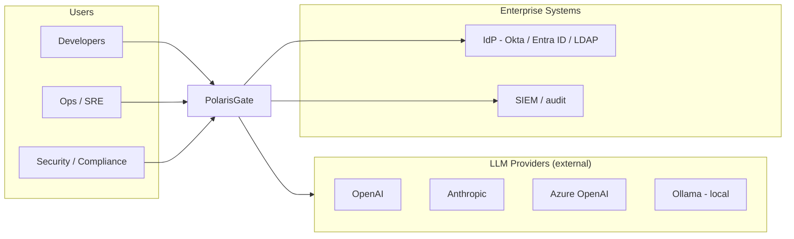
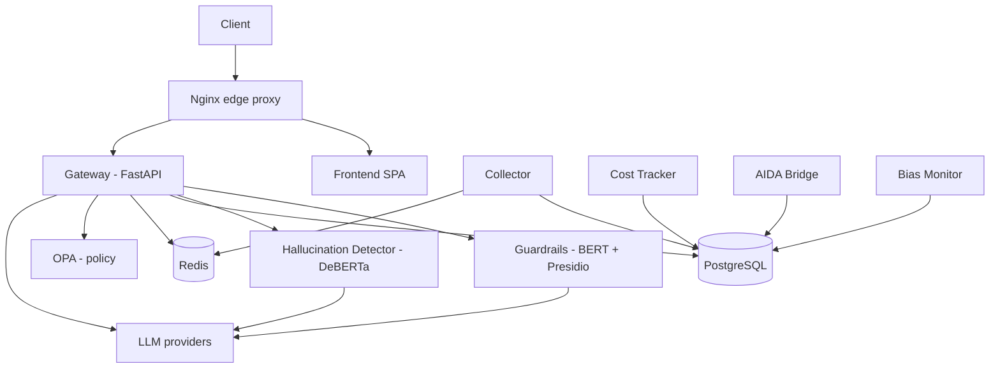
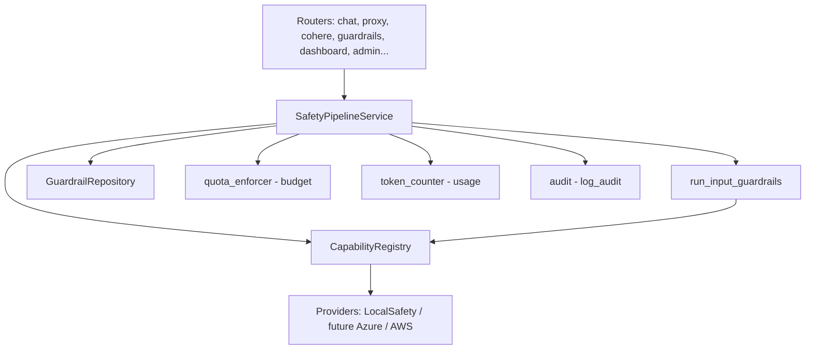
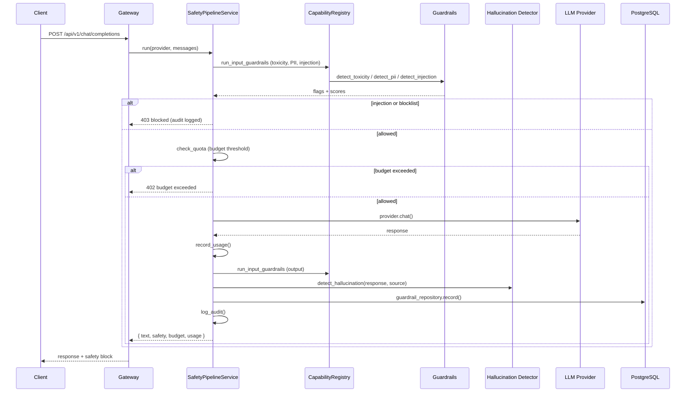
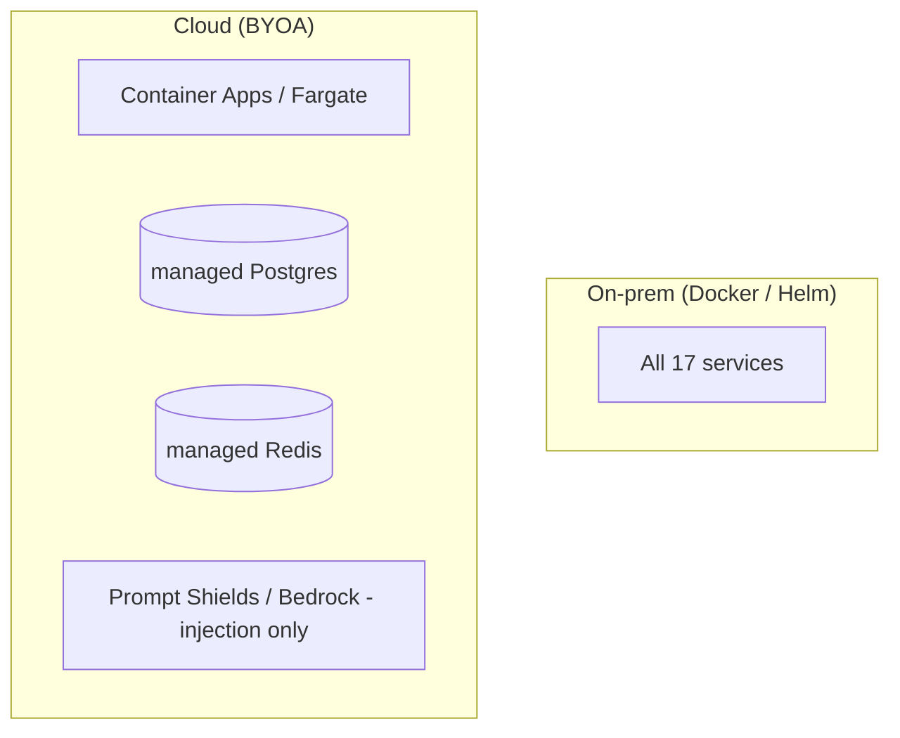

# PolarisGate — Technical Architecture Document

**Version:** 3.0
**Status:** Validated (security / ML / product review + AWS/Azure research)
**Owner:** Architecture
**Last updated:** 2026-08-26
**Framework:** arc42 (12 sections) · C4 diagrams · IEEE 42010 viewpoints

> **How to read this document:** Each section starts with *why it exists* (IEEE 42010:
> whose concern it answers). Diagrams follow the C4 model — Context (L1), Container
> (L2), Component (L3). This is the *single source of truth* for how PolarisGate is
> built; the older `to-be-blueprint.md` is the design rationale that produced it.

---

## 1. Introduction and Goals

*Answers: what is this system, and what must it achieve? (Stakeholders: executives, product, CISO)*

PolarisGate is a **self-hosted / BYOA AI safety platform** that sits in front of every
LLM call an organization makes and enforces three things, consistently:

1. **Safety** — toxicity, PII, prompt injection, and hallucination checks on every input and output.
2. **Budget** — a hard threshold gate that blocks requests when a team's spend is exhausted.
3. **Governance** — policy enforcement (OPA), audit trail, and multi-tenant access control.

### Business goals

| # | Goal | Measured by |
|---|---|---|
| G1 | Let enterprises adopt AI **without giving up data control** | Self-hosted / BYOA; data never leaves the customer's VPC |
| G2 | Be **provider-agnostic** (no vendor lock-in) | 11+ LLM providers behind one interface |
| G3 | Make safety **non-optional** on every route | Single pipeline, all routes converge on it |

### Top 3 quality goals

| # | Quality | Why it's the priority |
|---|---|---|
| Q1 | **Safety integrity** — no request bypasses a check | The whole product is safety |
| Q2 | **Data sovereignty** — Canadian PII handled in-VPC | The uncopyable moat |
| Q3 | **Operability** — deploy in minutes, upgrade in place | BYOA model requires it |

---

## 2. Constraints

*Answers: what forces shape every decision? (Stakeholders: architects, compliance)*

| Constraint | Type | Impact |
|---|---|---|
| **Canadian PII must be detected on our own ML** (Presidio + Canadian recognizers), never cloud PII APIs | Regulatory / product | PII detection is always in-VPC; cloud adds no PII value |
| **Self-hosted / BYOA** — deploy into the customer's account | Business | No vendor-hosted SaaS; per-customer infrastructure |
| **Apache 2.0** open source | Legal | Cloud ML (e.g. Prompt-Guard) must be an *optional*, license-isolated dependency |
| **No vendor lock-in** | Business | Provider abstraction layer is mandatory |
| **Prompt injection is a named v1 weakness** | Technical | Must use defense-in-depth cascade, not a single model |

---

## 3. Context and Scope (C4 Level 1)

*Answers: what does the system do, and who/what is outside it? (Stakeholders: everyone — this is the "map")*

**Scope in:** the gateway, safety services, governance, budget, dashboard.
**Scope out:** the LLMs themselves (external), the IdP (external), the SIEM (external).

**Key external systems:**

| System | Interface | Direction |
|---|---|---|
| LLM providers (11+) | OpenAI-compatible / native HTTP APIs | PolarisGate → provider |
| Okta / Entra ID / LDAP | SAML 2.0 / OIDC / LDAP | PolarisGate → IdP (auth) |
| SIEM | Audit export / webhooks | PolarisGate → SIEM |

---

## 4. Solution Strategy

*Answers: what are the 5 decisions that make this architecture cohere? (Stakeholders: architects)*

These are the load-bearing decisions. Everything else is a consequence of them.

| # | Decision | Rationale (one line) |
|---|---|---|
| S1 | **Hybrid topology** — gateway stays light, ML lives in dedicated services | Gateway handles latency-sensitive routing; ML services own their models; cloud mode runs the same ML in-VPC |
| S2 | **Interface-based providers** — `SafetyProvider` split into per-capability interfaces + a `CapabilityRegistry` | Lets you mix best-in-class point tools (Azure Prompt Shields for injection) with your own PII — this is the moat |
| S3 | **Three-pillar domain** — Safety + Budget + Governance | Each is a bounded context; they compose, not entangle |
| S4 | **Defense-in-depth injection** — regex → ML → LLM judge cascade | No single model is a single point of failure |
| S5 | **BYOA deployment** — deploy into the customer's cloud account | Data never leaves the customer's control; vendor has zero access |

**Why these five?** S1 and S2 are the *structural* core (they make cloud porting trivial). S3 is the *domain* core (it prevents the god-class problem). S4 and S5 are the *moat* (they're what competitors can't copy).

---

## 5. Building Block View (C4 Levels 2 & 3)

*Answers: what are the deployable units, and what's inside the important ones? (Stakeholders: developers, ops)*

### 5.1 Containers (C4 Level 2)

| Container | Responsibility | Tech | Scale profile |
|---|---|---|---|
| **gateway** | Routing, auth, safety pipeline orchestration, budget gate | FastAPI | Stateless, 2–8 replicas |
| **guardrails** | Toxicity (BERT), PII (Presidio+Canada), injection cascade | Python + ML | Stateful (models), 2–10 |
| **hallucination-detector** | Hallucination NLI (DeBERTa) | Python + ML | Stateful, 1–5 |
| **aida-bridge** | AIDA compliance integration | Python | 1 |
| **bias-monitor** | Bias detection (disabled — offline eval) | Python | 1 |
| **collector** | Telemetry / trace ingestion | Python | 1–2 |
| **cost-tracker** | Budget + cost accounting | Python | 1 |
| **frontend** | Dashboard SPA | static (nginx) | CDN |
| **nginx** | TLS, WAF, rate-limit, routing | nginx | 1 (edge) |
| **postgres** | All persistence (audit, budgets, usage, conversations) | PostgreSQL 15 | managed |
| **redis** | Sessions, rate-limit, cache | Redis 7 | managed |
| **opa** | Policy decision point | OPA | 1 |
| **ollama** | Local LLM (on-prem inference) | Ollama | 1 (GPU on-prem) |
| **prometheus/grafana** | Metrics + dashboards | — | 1 each |

### 5.2 Gateway components (C4 Level 3)

The gateway is the heart — it's the only container that orchestrates all three pillars.

| Component | Responsibility | Note |
|---|---|---|
| `routers/*` | HTTP endpoints (15 routers) | Thin — no business logic |
| `SafetyPipelineService` | Orchestrates input→block→budget→forward→usage→output→hallucination→audit | Application service (the pipeline) |
| `CapabilityRegistry` | Routes each safety capability to its provider | The moat (S2) |
| `GuardrailRepository` | Persists `guardrail_results` | Repository (no raw SQL in pipeline) |
| `quota_enforcer` / `token_counter` | Budget threshold + usage recording | Budget pillar |

**Why this shape matters:** the routers are thin, the pipeline is a *named, testable service*,
and the safety capabilities are *routed*, not hard-wired. That's what makes "add Azure
Prompt Shields" a one-file change.

---

## 6. Runtime View (C4 — dynamic behavior)

*Answers: how does a request actually flow at runtime? (Stakeholders: developers, SRE, security)*

The **primary flow** — a chat completion through the full safety pipeline:

**Key ordering guarantee** (locked by unit tests): *input guardrails → block → budget → forward → usage → output guardrails → hallucination → audit.* The provider is **never** called if injection, blocklist, or budget fails.

---

## 7. Deployment View

*Answers: where does this run? (Stakeholders: ops, architects, procurement)*

PolarisGate is **deployment-agnostic** — the same code runs three ways (decision S5).

| Environment | Mechanism | When |
|---|---|---|
| **On-prem / air-gap** | `docker-compose.yml` (all 17 services) | Defense, banks, healthcare |
| **Kubernetes** | Helm chart (`k8s/helm/polarisgate`) | On-prem clusters |
| **Cloud (BYOA)** | Bicep/Terraform → Azure Container Apps / AWS ECS Fargate, deploy *into* customer's account | AWS/Azure Marketplace |

**Cloud note:** in cloud, the ML services (`guardrails`, `hallucination-detector`) still run
**in-VPC** — the Canadian PII moat is never delegated to a cloud PII API. Cloud adds value
only on **injection** (Prompt Shields / Bedrock Guardrails).

---

## 8. Cross-cutting Concepts

*Answers: what rules apply to EVERY building block? (Stakeholders: developers)*

These are the horizontal concerns that every service must honor.

| Concept | Rule | Implementation |
|---|---|---|
| **Authentication** | Every request carries a JWT or `X-Service-Token` | `shared/security/auth.py`, `require_auth` dependency |
| **Tenancy** | Every request is scoped to a team (`tenant_context`) | `shared/tenant_context.py` middleware |
| **Safety on every path** | No route reaches an LLM without `run_input_guardrails` | All routers converge on `SafetyPipelineService` |
| **Fail-open vs fail-closed** | Safety checks **fail-open** (log + continue); budget **fails-open**; injection **fails-closed** (block on detection) | Explicit per-stage `try/except` in the pipeline |
| **Audit integrity** | Every action is tamper-evident (HMAC-chained) | `shared/audit.py` chain hashing |
| **Observability** | Structured JSON logs + Prometheus metrics + OpenTelemetry spans | `shared/logging.py`, `shared/telemetry.py` |
| **Resilience** | Managed-API calls go through a circuit breaker | `shared/circuit_breaker.py` |
| **PII masking** | PII is masked in audit logs | `shared/audit.py::_mask_pii` |

**Error-handling convention (the critical one):**

| Stage | Failure behavior |
|---|---|
| Toxicity / PII / hallucination | **Fail-open** — log a warning, return "not flagged" |
| Injection / blocklist | **Fail-closed** — block the request (403) |
| Budget | **Fail-open** — log, allow (never hard-break on infra) |
| Provider (LLM) | 502 to caller, logged |

---

## 9. Architecture Decisions (ADRs)

*Answers: what did we decide, and why — so future architects don't undo it unknowingly? (Stakeholders: architects)*

| # | Decision | Rationale | Reversible? |
|---|---|---|---|
| ADR-1 | **Hybrid topology** (gateway light, ML in services) — don't collapse into one process | ML models are heavy/stateful; gateway must scale independently | Yes |
| ADR-2 | **Capability registry** over monolithic `SafetyProvider` | Point-solution providers (injection-only) can't fit a fat interface; registry = the moat | Yes |
| ADR-3 | **Buy injection ML, build PII** | Injection is commoditized (Prompt-Guard/Lakera/Bedrock); Canadian PII is uncopyable | Injection: yes; PII: no |
| ADR-4 | **Threshold budget** (hard cutoff), no cost prediction | "Block when exceeded" is what enterprises accept as v1; prediction is over-engineering | Yes |
| ADR-5 | **PII always own ML**, even in cloud | Cloud PII APIs are US/English-centric and would destroy the Canadian moat | No (moat) |
| ADR-6 | **BYOA** (deploy into customer's account), not vendor SaaS | Data sovereignty is the differentiator; vendor has zero data access | No (moat) |
| ADR-7 | **Bias demoted** (interface slot kept, disabled) | Keyword stub is too crude to ship; EU AI Act still names bias, so keep the slot | Yes |

---

## 10. Quality Requirements

*Answers: what does "good" mean, measurably? (Stakeholders: QA, SRE, CISO)*

Quality tree → concrete, testable scenarios.

| Quality | Scenario | Target |
|---|---|---|
| **Performance** | A safety check adds latency to a request | < 200ms p95 per capability (local ML) |
| **Availability** | Gateway is up | 99.9% (cloud), depends on infra (on-prem) |
| **Safety integrity** | A toxic/injection input is never passed to the LLM | 100% (block before forward — enforced by ordering) |
| **Security** | No PII leaves the VPC | 0 egress of PII (enforced by in-VPC ML) |
| **Scalability** | 10 teams, 10K requests/day | Gateway autoscales 2–8; ML 2–10 |
| **Maintainability** | Add a new safety provider | 1 file + 1 config line (CapabilityRegistry) |
| **Operability** | Deploy from scratch | < 15 min (CloudFormation/Bicep) |

**Quality scenario (example, ISO 25010 style):**
> *Given* a chat request containing Canadian PII (e.g. a SIN), *when* it passes through
> the gateway, *then* the PII is detected and redacted **in-VPC** by our own Presidio+Canada
> recognizer — never sent to a cloud API.

---

## 11. Risks and Technical Debt

*Answers: what's known-broken or known-risky? (Stakeholders: everyone — honesty section)*

### Active risks

| # | Risk | Impact | Mitigation |
|---|---|---|---|
| R1 | **Prompt injection TPR is ~71%** (Prompt-Guard) | Indirect injection may slip through | Defense-in-depth cascade (regex→ML→LLM judge); named v1 weakness |
| R2 | **ML services are stateful** (models in memory) | Cold-start latency on scale-out | `minReplicas=1`; GPU serving at scale |
| R3 | **Ollama on CPU is slow** (dev-only) | Long local responses | Mock provider default; native ollama on GPU |

### Technical debt (from the engineering review — now mostly resolved)

| Debt | Status |
|---|---|
| God-classes (`guardrails/worker.py` 781 lines, `cost_tracker.py` 421) | ✅ Split (cache + model loaders extracted; cost-tracker already split) |
| Fat `SafetyProvider` interface | ✅ Split into 6 capability interfaces + registry |
| Two LLM abstractions | ✅ Consolidated to one (`BaseProvider`) |
| No domain layer / raw SQL in pipeline | ✅ Repository (`GuardrailRepository`) extracted |
| Inline pipeline (no orchestrator) | ✅ `SafetyPipelineService` extracted |

### Remaining work (Tier 2 — operational correctness)

| Area | Status |
|---|---|
| Cloud providers (`AzureSafetyProvider`/`AWSSafetyProvider`) — factory still falls back to local | ⬜ Not implemented (Gap 7) |
| IaC (Bicep/Terraform/CloudFormation) + marketplace listing | ⬜ Not built |
| SOC 2 Type II, FedRAMP package | ⬜ Not started |
| Load/chaos testing, SLO dashboards | ⬜ Not started |

---

## 12. Glossary

| Term | Definition |
|---|---|
| **BYOA** | Bring Your Own Account — deploy PolarisGate *into* the customer's cloud, not the vendor's |
| **Capability Registry** | The component that routes each safety check to its provider (the moat) |
| **Hybrid topology** | Lightweight gateway + dedicated ML services, not a monolith |
| **Defense-in-depth** | Multiple independent detection layers (regex → ML → LLM judge) |
| **Fail-open / fail-closed** | On failure, allow (open) vs block (closed) |
| **PII** | Personally Identifiable Information |
| **Presidio** | Microsoft's open-source PII detection engine (extended with Canadian recognizers) |
| **NLI** | Natural Language Inference — the technique behind hallucination detection |
| **OPA** | Open Policy Agent — policy decision point |
| **arc42** | The 12-section template this document follows |
| **C4** | Context/Container/Component/Code — the diagram levels used here |

---

*End of Technical Architecture Document. This is the single source of truth for how
PolarisGate is built; changes to the architecture should update this document + add an ADR.*

